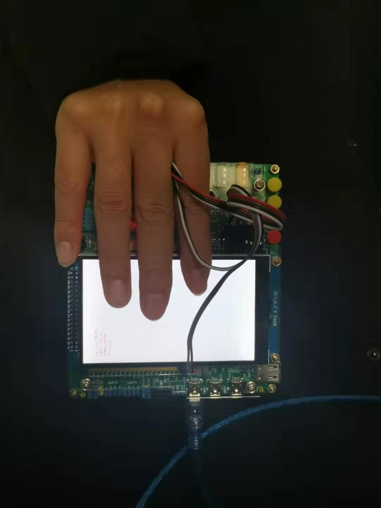
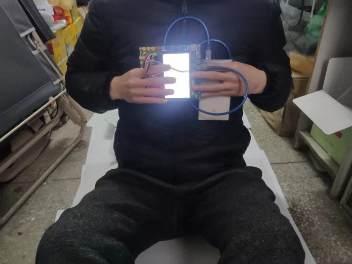
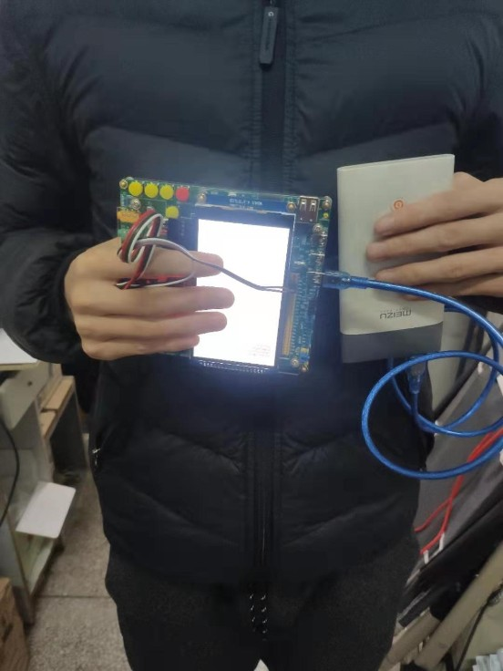
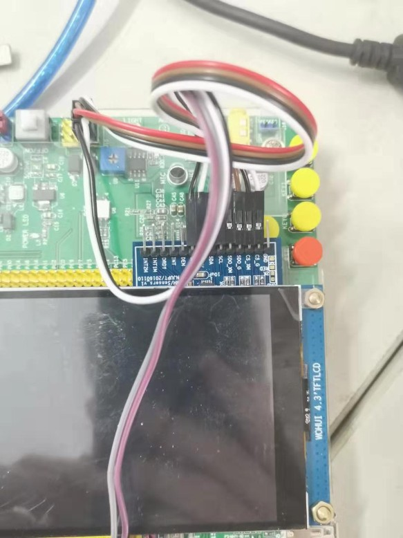
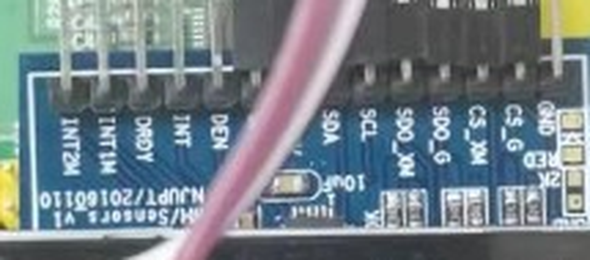

# 数据集的采集姿势与传感器固定方式（据 `九轴数据文件/ReadMe.doc` 整理）

> 原始出处：`D:\数据文件\数据文件\九轴数据文件\ReadMe.doc`（标题：**LSM9DS0 六轴数据采集基本信息说明**）。
> 下面的图片是从该 .doc 内嵌的原图里抽出来的（不是截屏），分辨率为原始尺寸。

## 为什么这一页重要

数据集是**在"手持这块开发板"的姿势下录的**（见下图）。这意味着：

- 算法的阈值（0.18 g）、动态幅度、重力在各轴的分布，**都和这个握法绑定**；
- 现场验收时如果改成绑在腰上、塞口袋、手环佩戴，**参数必须重标**；
- 换一块板、或把传感器模块翻个面插，**三个轴的方向就变了**，阈值同样要重标。

---

## 一、单片机拿取方式

ReadMe 原文：**"日常行走、跑步、爬楼梯时 STM32 单片机拿取的方式如图 1 所示、仰卧起坐时……如图 2 所示、跳绳时……如图 3 所示"**。

### 图 1 — 日常行走 / 跑步 / 爬楼梯（**本课题用的就是这一种**）

单手从背面扣住板子、屏幕朝外，板子近似竖直、屏幕长边水平。传感器模块插在屏幕上方那一排排母里。

### 图 2 — 仰卧起坐

坐在床上，双手捧板在胸前。（不是本课题的数据，但说明"同一块板换个姿势就是另一个动作"。）

### 图 3 — 跳绳

站立，单手持板在腹前，另一只手拿跳绳手柄 / 侧面挂着充电宝供电。

---

## 二、传感器固定方式

### 图 4 — 九轴模块插在开发板排母上

放大看丝印（图 4 左上那块蓝色小板）：

能读出来的信息：

| 项 | 内容 |
|---|---|
| 模块型号 | 板上有 **`HJ/Sensors V1`** 字样（第三方 LSM9DS0 转接板，不是 ST 官方评估板） |
| 引出的引脚 | `VDD`、`SCL`、`SDA`（被线挡住一部分）、`SDO_XM`、`SDO_G`、`CS_XM`、`CS_G`、`DEN`、`INT`、`DRDY`、`INT1M`、`INT2M` |
| 与数据手册的对应 | `CS_XM` / `CS_G` = 两套片选；`SDO_XM` / `SDO_G` 兼作 I2C 的 SA0 → 和 `hardware-protocol.md` §7.1 写的"一颗芯片两套地址"完全对得上 |
| 板上还有 | `10uF` 电容、`1k` 上拉电阻（I2C 用的） |

> ⚠️ 上面这些是从照片放大读出来的，**以你手上实际那块板为准**，接线前先用万用表确认 `CS_G` / `CS_XM` 是否已经上拉到 VDD（I2C 模式要求两个片选都为高）。

---

## 三、从数据反推的轴向（上板时要对着核）

`上三层楼数据.txt` 全程三轴加速度均值（`/16384` 换算成 g）：

| 轴 | 均值 | 说明 |
|---|---|---|
| ax | −0.357 g | — |
| **ay** | **+1.058 g** | **重力主要落在这个轴上 → +Y 大致朝上** |
| az | −0.335 g | — |

归一化后约 **(−0.31, +0.91, −0.29)**，即 +Y 与重力方向夹角约 **25°**，板子绕 X、Z 各倾了 20° 出头（手持自然倾斜）。

**这条的两个用途：**

1. **上板自检**：真机静置时如果 `ay ≈ +1 g`、`ax/az ≈ ±0.3 g`，说明轴向和数据集一致，阈值可以直接沿用；
2. 如果 `az` 变成 +1 g、`ay` 变小，说明**模块被转了 90°**，则要么把板子转回去，要么把 `gait_algo.c` 里的轴重映射一下——但**不要直接照抄 0.18 g**。

> 为什么现在的算法不依赖这个方向：`gait_algo.c` 用的是**加速度模长 `|a|`**（三轴平方和开根），旋转不变。
> 这是它能"换个握法也能用"的原因，也是它**无法判上/下楼**的原因——模长把方向信息丢掉了。

---

## 四、上板前的检查清单

- [ ] 用**同一块板、同一个插法**（模块插在 LCD 上方那排排母），拍照留档；
- [ ] 静置采集 10 s，确认 `|a| ≈ 1.000 g`、`ay` 主导、`ax/az` 约 ±0.3 g；
- [ ] 确认 `CS_G`、`CS_XM` 都为高电平（I2C 模式）；陀螺地址 `0x6A`、加速度+磁力计地址 `0x1D`；
- [ ] 读 `WHO_AM_I_G (0x0F)` 与 `WHO_AM_I_XM (0x0F)` 确认芯片在线；
- [ ] 手持板子按图 1 的姿势原地走 1 min，用 `gyro_check.exe` 确认陀螺 σ 能上去（验证陀螺到底出不出数）；
- [ ] 爬一趟真实的楼梯，用 `tools/algo_check.exe` 离线跑一遍，和 `上三层楼数据.txt` 的 68 级 / 3 层对比 —— **这才是真机的第一次标定**。

---

## 附：原 ReadMe 全文（转录）

> **LSM9DS0 六轴数据采集基本信息说明：**
> **一、单片机拿取方式**　日常行走、跑步、爬楼梯时 STM32 单片机拿取的方式如图 1 所示、仰卧起坐时 STM32 单片机拿取的方式如图 2 所示、跳绳时 STM32 单片机拿取的方式如图 3 所示
> **二、九轴传感器固定方式**　九轴传感器固定的方式如图 4 所示。
> **三、参数信息说明**　日常行走、跑步、上下楼梯等不同的应用场景采用的是同一工程，不同应用场景的所有数据的采样频率都是 50Hz。用九轴传感器采集数据文件，每一行自左往右的数据依次是角速度 x、y、z、加速度 x、y、z。
> **四、数据文件介绍**　日常行走数据.txt 是日常行走采样时长为 1min 的数据。跑步数据.txt 是跑步采样时长为 1min 的数据。下三层楼数据.txt 是下三层楼采样的数据。上三层楼数据.txt 是上三层楼采样的数据。仰卧起坐数据.txt 是做 20 个标准仰卧起坐采样的数据。跳绳数据.txt 是跳绳 50 次采样的数据。混合运动数据.txt 是依次行走 100 步 + 上 2 层楼 + 跑步 100 步 + 跳绳 10 个混合运动时采样数据。
