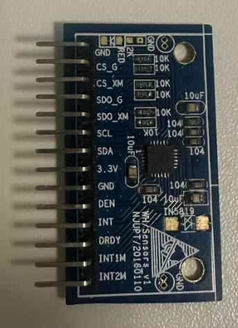

# LSM9DS0 九轴模块接线表（对照实物丝印）

> 模块：`HJ/Sensors V1`（丝印 `W/H/Sensors V1` + `N.JUPT/20160110`），**1×14 单排针，2.54 mm**
> 开发板：`STM32F407_V8`（4.3" 屏 / 板载 ST-Link / 板载 CH340）
>
> **⚠️ 实测修正（2026-10-31，真机验证）**
> 这块模块的两处实际情况和查资料得到的不一样，第一次接线一定按下面这个来：
> 1. **陀螺的 I2C 地址是 `0x6B`，不是 `0x6A`** —— 模块把 `SDO_G` 拉高了。
>    固件已做双地址自适应（先试 0x6A，不通自动换 0x6B），日志会打印
>    `[FIX] 陀螺改在 0x6B 应答（SDO_G 被拉高）`。
> 2. **`CS_G` / `CS_XM` 可以不接** —— 模块内部有上拉，悬空时是 I2C 模式。
>    实测：`CS_XM` 不接，`WHO_AM_I_XM` 正常返回 `0x49`。
>    **所以最少只要 4 根线：GND / 3.3V / SCL / SDA。**
>
> ⚠️ 但 `CS_G` 那根线**千万不要接到 GND 上** —— 拉低会让陀螺进入 SPI 模式，
> 表现为 `WHO_AM_I_G = 0xFF`（加速度正常、陀螺不通），很容易误判成模块坏。



---

## 一、模块引脚全表（从有 `2K` 电阻那一头往下数）

| 针号 | 丝印 | 接到板子哪里 | 必需 | 说明 |
|---|---|---|---|---|
| **1** | `GND` | 板 GND | ✅ | 地 |
| **2** | `CS_G` | 板 **3.3V** 或**空着** | 可选 | 陀螺片选。**接 GND 会进 SPI 模式导致读不到** |
| **3** | `CS_XM` | 板 **3.3V** 或**空着** | 可选 | 加速度片选。实测空着也能工作 |
| 4 | `SDO_G` | 空着 | — | 地址选择位；**本模块被拉高 → 陀螺地址 0x6B** |
| 5 | `SDO_XM` | 空着 | — | 地址选择位；本模块拉低 → 加速度地址 0x1D |
| **6** | `SCL` | 板 **PB6** | ✅ | I2C 时钟 |
| **7** | `SDA` | 板 **PB7** | ✅ | I2C 数据 |
| **8** | `3.3V` | 板 **3.3V** | ✅ | 模块电源（⚠️ 不是 5V） |
| **9** | `GND` | 板 GND | ✅ | 第二个地，和 1 针并联更稳 |
| 10 | `DEN` | 空着 | — | 数字使能（不用） |
| 11 | `INT` | 空着 | — | 中断输出（不用） |
| 12 | `DRDY` | 空着 | — | 数据就绪（不用） |
| 13 | `INT1M` | 空着 | — | 中断（不用） |
| 14 | `INT2M` | 空着 | — | 中断（不用） |

> 模块右上角那个 `RED` + `2K` 是**红色电源指示灯**的丝印，不是排针
> （而且那几个金焊盘是空的，实际没焊灯，不要指望它亮）。

---

## 二、板子侧的三个接点

| 板子接点 | 位置 | 形状 |
|---|---|---|
| **3.3V / GND** | **电源开关正下方**，右侧边缘 | 1×3 黄色排针，**从上往下：5V / GND / 3.3V** |
| **PB6** | 黄色 I/O 排针上，按丝印找 `PB6` | 每针旁边印了引脚名 |
| **PB7** | 同上，找 `PB7` | 同上 |

```
电源开关下方的 3 针排针：
   [ ● ]  5V输出      ← 千万别用
   [ ● ]  GND         ← 用它
   [ ● ]  3.3V输出    ← 用它
```

---

## 三、接线图（共 7 根线）

```
        LSM9DS0 模块                      STM32F407 开发板
   ┌──────────────────────┐          ┌──────────────────────────┐
   │ 1  GND        ────────┼──────────┼──  GND（3针排针 中）      │
   │ 2  CS_G       ────────┼─────┐    │                          │
   │ 3  CS_XM      ────────┼───┐ │    │                          │
   │ 4  SDO_G           ×  │   │ │    │                          │
   │ 5  SDO_XM          ×  │   │ │    │                          │
   │ 6  SCL        ────────┼───┼─┼────┼──  PB6                   │
   │ 7  SDA        ────────┼───┼─┼────┼──  PB7                   │
   │ 8  3.3V       ────────┼───┴─┴────┼──  3.3V（3针排针 下）     │
   │ 9  GND        ────────┼──────────┼──  GND（同一根，可选）    │
   │ 10 DEN             ×  │
   │ 11 INT             ×  │          × = 空着不接
   │ 12 DRDY            ×  │
   │ 13 INT1M           ×  │
   │ 14 INT2M           ×  │
   └──────────────────────┘
```

**用线数量：**

| 信号 | 根数 | 说明 |
|---|---|---|
| 3.3V（第 2、3、8 针） | **3 根** | 或者 1 根 + 分线 |
| GND（第 1、9 针） | **2 根** | 至少接 1 根，都接更稳 |
| SCL（第 6 针） | 1 根 | → PB6 |
| SDA（第 7 针） | 1 根 | → PB7 |
| **合计** | **7 根** | 最少 5 根（3.3V 只接第 8 针、GND 只接第 1 针） |

> 想让模块插得稳，可以焊一个 14 针排母在模块上，或者直接用 7 根母对母杜邦线。

---

## 四、上电前必做的 4 项检查

```
① 万用表通断档：模块第 8 针（3.3V） ↔ 板子 3.3V 排针   应通
② 万用表通断档：模块第 1 针（GND）  ↔ 板子 GND 排针     应通
③ 量 3.3V 与 GND 之间的电阻：不能接近 0（短路会烧模块）
④ 确认没有任何一根线误接到 5V 输出那一针
```

**接反 VDD / GND 会立刻烧掉模块。这 4 项别省。**

---

## 五、如果 I/O 排针上找不到 PB6 / PB7

板上有两条黄色 I/O 排针，**每针旁边都印了引脚名**（能看到 `PC10`、`PB14`、`PG13` 这种小字），照着找 `PB6` / `PB7` 即可。

万一确实没引出来，用**备用方案：PB8 / PB9**（板上通常标成 `IIC_SCL` / `IIC_SDA` 的座）：

**改 `D:\STM32\stair_mcu\HARDWARE\IIC\myiic.h`：**

```c
#define SDA_IN()  {GPIOB->MODER&=~(3<<(9*2));GPIOB->MODER|=0<<9*2;}
#define SDA_OUT() {GPIOB->MODER&=~(3<<(9*2));GPIOB->MODER|=1<<9*2;}
#define IIC_SCL    PBout(8)
#define IIC_SDA    PBout(9)
#define READ_SDA   PBin(9)
```

**再改 `myiic.c`：**

```c
GPIO_InitStructure.GPIO_Pin = GPIO_Pin_8 | GPIO_Pin_9;   // 原来是 6 | 7
```

改完 `F7` 重编译、`F8` 重下载。

> PB8/PB9 同时接着板载 WM8978 音频 codec（地址 0x1A）。I2C 是总线结构，**地址不冲突就能共存**
> （九轴是 0x6A / 0x1D），只要不调用音频驱动就完全没影响。

---

## 六、接好后怎么验证

```
① 按一下 系统复位（RST，红色按键）
② 串口助手 115200，看输出
```

**成功：**

```
==== 楼梯层数计数（上楼）· 硬件采集端 ====
LSM9DS0  I2C: PB6=SCL  PB7=SDA   采样率 50 Hz
[OK] WHO_AM_I_G=0xD4  WHO_AM_I_XM=0x49
[OK] 开始采集：每 20ms 输出一行  gx gy gz ax ay az
64876 161 64597 65338 14289 63033
```

**失败对照：**

| 串口显示 | 原因 | 处理 |
|---|---|---|
| `WHO_AM_I_G = 0xFF` | I2C 无应答 | 查 SCL/SDA 是否接反、模块 3.3V 有没有到 |
| `WHO_AM_I_G = 0x00` | 总线被拉低 | 查 `CS_G` / `CS_XM` 是否真的到了 3.3V |
| `G = 0xD4` 但 `XM = 0xFF` | 陀螺通、加速度不通 | `CS_XM`（第 3 针）没接 3.3V |
| 完全没输出 | 固件没跑起来 | 先拔掉模块，单独确认 banner 能打印 |
| 数字全 0 | SDA/SCL 接反或无上拉 | 互换 SCL/SDA 试，检查模块 10K 上拉 |

---

## 七、常见错误清单

- ❌ 把模块 `3.3V` 接到板子的 **5V** 输出 → **烧模块**
- ❌ `CS_G` / `CS_XM` 悬空 → `WHO_AM_I` 读出来是 0x00 或 0xFF
- ❌ SCL / SDA 接反 → 完全读不到
- ❌ 只接 3.3V 不接地 → 读到乱码
- ❌ 杜邦线插在排针外侧、没插进金属片 → 时通时不通，数据乱跳
- ❌ 带电插拔模块 → 容易打坏 I2C 引脚，**先断电再接**

---

## 八、参考

- 寄存器配置与量程换算：`docs/hardware-protocol.md` §7
- 固件工程：`D:\STM32\stair_mcu\`（`HARDWARE/LSM9DS0`、`HARDWARE/IIC`）
- 采集姿势与传感器固定：`docs/mounting.md`
